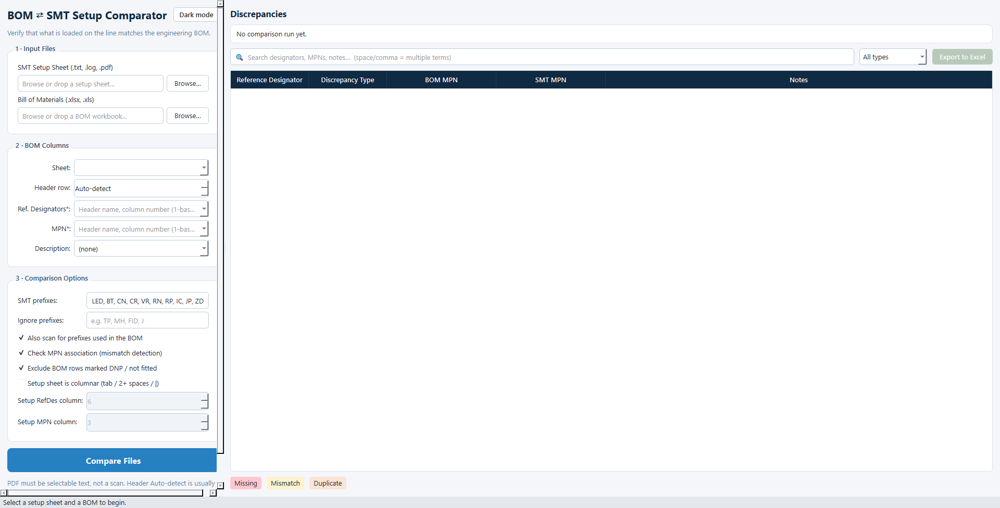
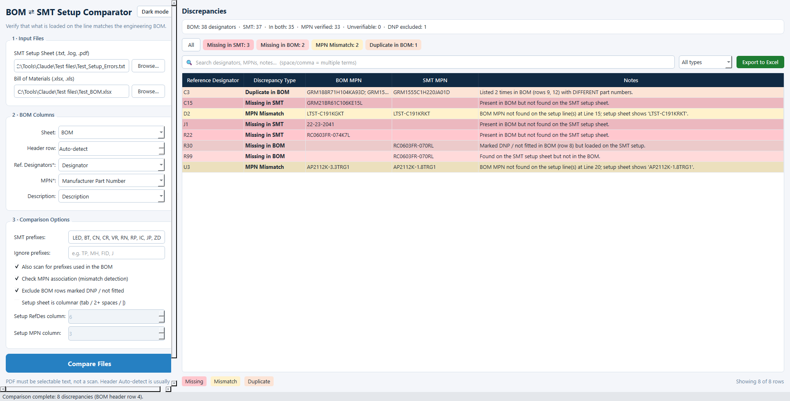
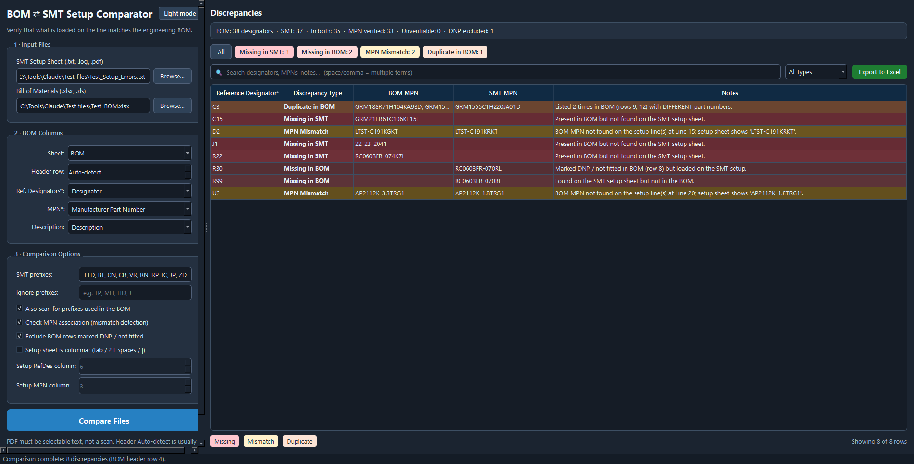

# BOM SMT Comparator (Python)

Desktop app that checks an SMT feeder setup sheet against an engineering BOM. It runs locally in Python 3.12 with a PySide6 window. Files stay on your PC.







## What it does

The app reads reference designators from a BOM workbook and from an SMT setup sheet, then lists differences:

- **Missing in SMT** — in the BOM, not on the setup sheet
- **Missing in BOM** — on the setup sheet, not in the BOM (including DNP parts that were loaded)
- **MPN Mismatch** — same designator, different part number
- **Duplicate in BOM** / **Duplicate in SMT** — the same designator listed more than once

Optional checks:

- Learn extra prefixes from the BOM
- Verify manufacturer part numbers on the setup-sheet lines
- Exclude BOM rows marked DNP / not fitted
- Columnar setup sheet — only for machine dumps with a fixed designator column (tab / 2+ spaces / `|`)

You can search or filter the table (click a summary chip to filter by type) and export a discrepancy report to Excel. **Dark mode** is a shop-floor theme. **Ctrl+Enter** compares; **Ctrl+E** exports.

## What you need

- Windows (tested with Python 3.12)
- Python 3.12

Supported inputs:

- **SMT setup sheet:** `.txt`, `.log`, or a text-based `.pdf` (not a scanned image)
- **BOM:** `.xlsx`, `.xls`, or `.xlsm`

## How to run

From a terminal in this folder:

```powershell
python -m venv venv
.\venv\Scripts\python.exe -m pip install -r requirements.txt
.\venv\Scripts\python.exe bom_smt_comparator.py
```

If the virtual environment already exists, skip the first two lines and run:

```powershell
.\venv\Scripts\python.exe bom_smt_comparator.py
```

## How to compare files

1. Browse or drop the **SMT setup sheet** (left panel, first field).
2. Browse or drop the **BOM Excel** file. Sheet, header row, designator, MPN, and description columns are filled in automatically when possible.
3. Header row **Auto-detect** is usually enough. Change **Sheet** or columns if your workbook uses unusual names.
4. Adjust **SMT prefixes** if your designators are not the usual `R`, `C`, `U`, and so on.
5. Click **Compare Files** (or press Ctrl+Enter).
6. Filter or search the discrepancy table, or click a colored chip. Click **Export to Excel** (or press Ctrl+E) to save a report.

## Notes

- Password-protected workbooks and PDFs are not supported. Save an unprotected copy first.
- Image-only PDFs need OCR first, or export the setup sheet as text from the SMT software.
- Comparison runs on this machine. Your BOM and setup files are not uploaded anywhere.
